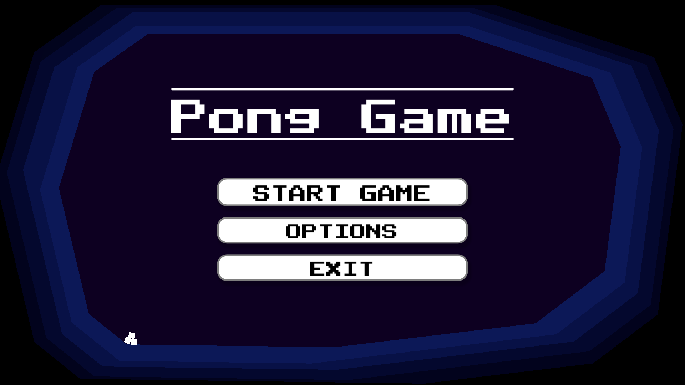
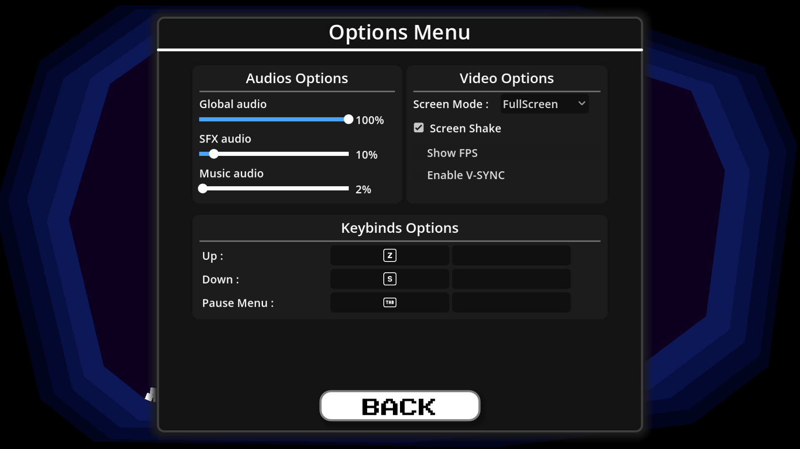
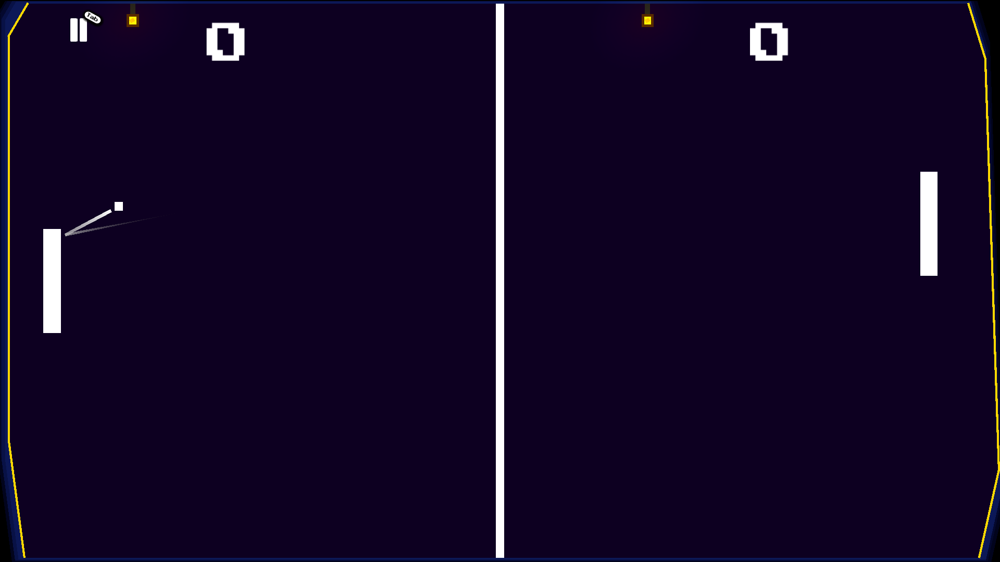
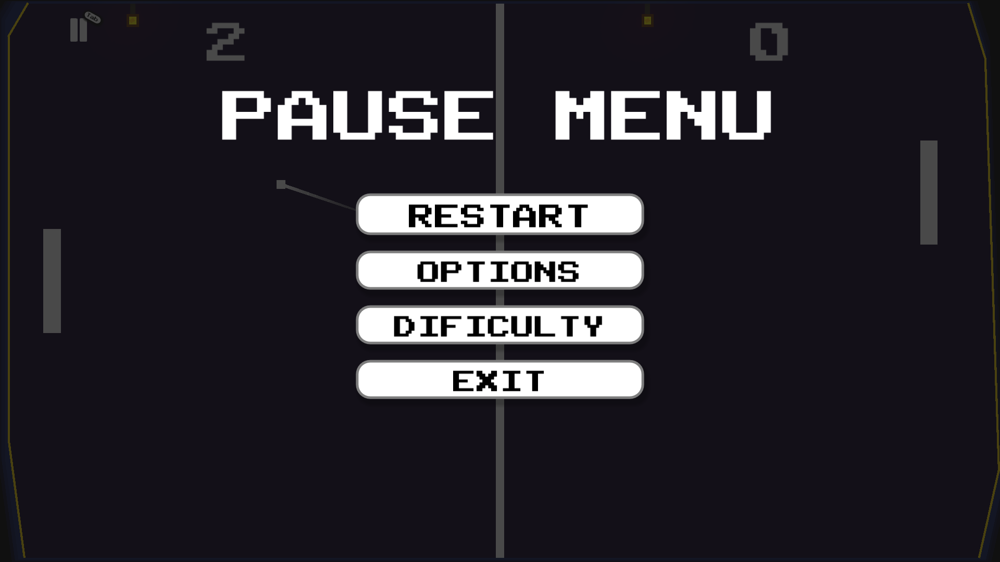

# Pong Game – Godot

A little 2D Pong game made with Godot Engine (the best engine, obviously).

  
  
  
  

## Features

- Mobile and PC support
- Modern settings menu
- More features coming soon...

## Support / Credits / License

Need help or found a bug? Feel free to open an issue!

Made by **MERCRED**.

Licensed under the [MIT License](https://choosealicense.com/licenses/mit/).
